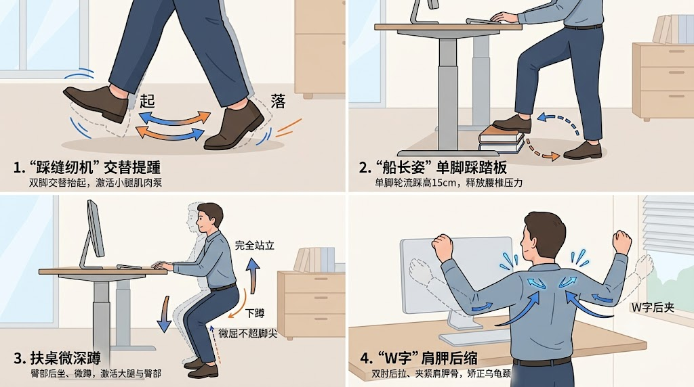

## 坐着办公 vs 站立办公
1. 单次连续90分钟久坐是流行病学公认的高危阈值；
2. 集中运动与碎片化打断久坐作用于不同的生理机制，两者无法互相替代。 单次30分钟运动无法完全抹平全天连续久坐造成的急性代谢停滞，而零散走动也无法替代系统运动对心肺耐力和肌肉力量的提升。别把“起身走走”当成放弃运动的借口；
3. 单纯“站着不动”本质上是把“坐姿静止”换成了“站姿静止”。长时间静态站立不仅无法降低心血管疾病风险，每天站立超过2小时后，每多站30分钟，静脉曲张与体位性循环障碍的风险反而上升11%。
4. 4类可无缝叠加的“边站边动”微动作：
   
5. 每天运动半小时为您提供强大的心肺底盘与肌肉储备，而每20～30分钟起身活动2分钟则是守护全天血糖平稳与血管通畅的代谢开关。工作日白天用“每半小时起身走2分钟（或坐姿提踵）”打破静止，每周再保留3～5次30分钟的集中锻炼，才是现代办公族对抗久坐伤害的完整解药;
6. 